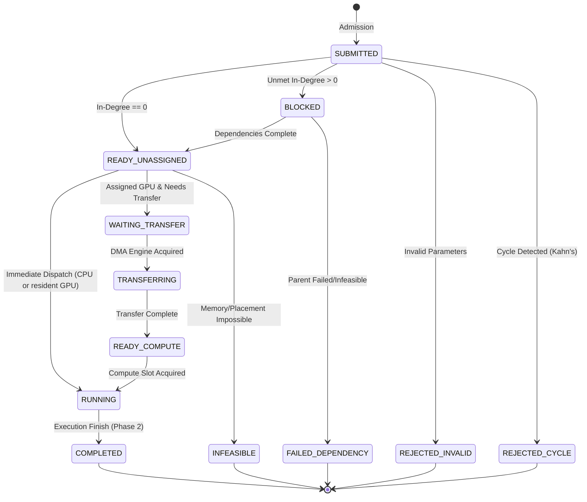

# HeteroSched: System Architecture Specification

## 1. Architectural Philosophy & Overview

**HeteroSched** is an industrial-grade, deterministic C++20 discrete-event simulator (DES) designed to model, analyze, and optimize heterogeneous workload scheduling across multi-core CPUs, discrete GPUs, and bidirectional PCIe DMA transfer engines.

Heterogeneous computing architectures (such as NVIDIA Grace Hopper, DGX systems, and standard workstation PCIe accelerators) present complex scheduling challenges:
1. **Asymmetric Compute Capacity**: CPU cores excel at low-latency sequential and control-flow heavy tasks; GPU streaming multiprocessors deliver high throughput for parallel compute kernels.
2. **Data Movement Bottlenecks**: PCIe bus transfers introduce latency and contention. Dispatching a task to GPU requires staging input buffers across PCIe before kernel execution can begin.
3. **Memory Pressure & Lifetime**: Discrete GPU VRAM is finite and non-pageable in real-time execution. Allocating memory without pre-reservation risks catastrophic runtime Out-of-Memory (OOM) failures or deadlock.
4. **DAG Dependencies**: Computational workflows are structured as Directed Acyclic Graphs (DAGs), where child tasks depend on outputs generated by predecessor tasks.

HeteroSched solves these modeling challenges with **cycle-accurate simulation semantics**, **deterministic multi-phase event dispatching**, and **provable invariant verification**.

```
                               +-----------------------------+
                               |     Workload JSON (DAG)     |
                               +-----------------------------+
                                              |
                                              v
                               +-----------------------------+
                               |   Kahn's Validation & Sort  |
                               +-----------------------------+
                                              |
                                              v
+------------------------------------------------------------------------------------------+
|                               HeteroSched Simulation Engine                              |
|                                                                                          |
|   +-----------------------+     +-----------------------+     +----------------------+   |
|   | 6-Phase Event Engine  |<--->|    Resource Pool      |<--->| Transfer Engine      |   |
|   | - Priority Queue      |     | - CPU Slots (4)       |     | - DMA Engines (1-2)  |   |
|   | - Tie-Breaking Logic  |     | - GPU Slots (2)       |     | - PCIe Transfer Queue|   |
|   | - Dispatch Drain Loop |     | - VRAM Tracking & Ref |     | - Bandwidth Modeling |   |
|   +-----------------------+     +-----------------------+     +----------------------+   |
|                                              ^                                           |
|                                              |                                           |
|                                 +-------------------------+                              |
|                                 |   6 Scheduling Policies |                              |
|                                 | (CPU, GPU, FIFO, EFT,   |                              |
|                                 |  Slack, Full HEFT Rank) |                              |
|                                 +-------------------------+                              |
+------------------------------------------------------------------------------------------+
                                  /                        \
                                 v                          v
                  +---------------------------+  +---------------------------+
                  |  Chrome / Perfetto Trace  |  |  Metrics Summary & JSON   |
                  |  (trace.json)             |  |  (results.json)           |
                  +---------------------------+  +---------------------------+
```

---

## 2. Deterministic 6-Phase Discrete-Event Loop

Standard discrete-event simulators often suffer from **insertion-order non-determinism** when multiple distinct events occur at the exact same simulation microsecond. HeteroSched eliminates this through a strict **6-Phase Execution Pipeline** per tick:

### Event Priority Queue Ordering
Events in the priority queue $\mathcal{Q}$ are ordered lexicographically by the tuple:
$$\text{Order}(E) = (\text{tick}(E), \, \text{phase}(E), \, \text{sequence\_id}(E))$$

Where:
- $\text{tick} \in \mathbb{N}_0$ (simulation microseconds).
- $\text{phase} \in \{1, 2, 3, 4, 5, 6\}$ (strictly ordered execution phases).
- $\text{sequence\_id} \in \mathbb{N}_0$ (monotonically increasing integer assigned upon event creation to ensure deterministic FIFO ordering within the same phase).

### Phase Definitions

| Phase | Name | Operations & Invariants |
|---|---|---|
| **Phase 1** | `TRANSFER_COMPLETION` | - Process DMA transfer completions.<br>- Release DMA engine slot to transfer queue.<br>- Transition task from `TRANSFERRING` to `READY_COMPUTE`.<br>- Push task to `ready_compute_tasks_` queue. |
| **Phase 2** | `TASK_COMPLETION` | - Process task kernel execution completions.<br>- Transition task from `RUNNING` to `COMPLETED`.<br>- Mark output buffers resident on host/device.<br>- Decrement dependent task prerequisites.<br>- Add newly unblocked tasks to `READY_UNASSIGNED`. |
| **Phase 3** | `RESOURCE_RELEASE` | - Free compute slots (CPU worker or GPU execution stream).<br>- Reclaim working memory and input memory buffers.<br>- Reclaim unreferenced parent output buffers.<br>- Drain `ready_compute_tasks_` if GPU slot freed. |
| **Phase 4** | `DEPENDENCY_RESOLUTION` | - Sweep unblocked tasks whose in-degree reached 0.<br>- Verify all prerequisite outputs are resident.<br>- Flag tasks as eligible for scheduler placement. |
| **Phase 5** | `TASK_ARRIVAL` | - Inject newly arriving external DAG tasks at current tick.<br>- Validate task parameters and add to ready pool. |
| **Phase 6** | `SCHEDULER_DISPATCH` | - Execute active scheduling policy selector.<br>- Iteratively dispatch tasks until no feasible task can be scheduled.<br>- If task assigned to GPU needs DMA, transition to `WAITING_TRANSFER` and enqueue in DMA engine.<br>- If task ready for immediate compute, reserve slot and transition to `RUNNING`. |

### Monotonicity & Anti-Paradox Rules
1. **Strictly Positive Durations**: All compute durations $T_{\text{compute}}$ and transfer durations $T_{\text{transfer}}$ must be $\ge 1\,\mu\text{s}$. Zero-duration events are strictly forbidden, preventing backwards-phase event insertion within the same tick.
2. **Dispatch Drain Loop**: Phase 6 executes in a greedy while-loop until the scheduling policy returns `nullopt` or resources are exhausted.
3. **Deadlock Detection**: If $\mathcal{Q} = \emptyset$ and tasks remain in `READY_UNASSIGNED`, `WAITING_TRANSFER`, or `READY_COMPUTE` with no running compute or transfer events active, the simulator flags an invariant violation and transitions stuck tasks to `INFEASIBLE`.

---

## 3. Formal Task State Machine (10 States)

A task $T_i$ moves through a strictly validated finite state machine (FSM):



### State Catalog

| State ID | State Name | Scope | Description |
|---|---|---|---|
| 0 | `SUBMITTED` | Pre-sim | Task parsed from workload definition. |
| 1 | `REJECTED_INVALID` | Pre-sim | Rejected during validation (negative runtime, unknown dependency). |
| 2 | `REJECTED_CYCLE` | Pre-sim | Rejected during Kahn's topological sort (cyclic dependency). |
| 3 | `BLOCKED` | Runtime | Waiting for one or more parent dependencies to reach `COMPLETED`. |
| 4 | `READY_UNASSIGNED` | Runtime | All dependencies satisfied; waiting for scheduler assignment. |
| 5 | `WAITING_TRANSFER` | Runtime | Assigned to GPU; queued in FIFO waiting for a free PCIe DMA engine. |
| 6 | `TRANSFERRING` | Runtime | Asynchronously moving input data across PCIe via active DMA engine. |
| 7 | `READY_COMPUTE` | Runtime | Data transfer complete in VRAM; waiting for a free GPU compute slot. |
| 8 | `RUNNING` | Runtime | Occupying compute slot (CPU worker or GPU stream) executing kernel. |
| 9 | `COMPLETED` | Terminal | Finished compute execution; output data resident; memory freed. |
| 10 | `INFEASIBLE` | Terminal | Permanent resource starvation (e.g., memory exceeds total capacity). |
| 11 | `FAILED_DEPENDENCY` | Terminal | Blocked on a parent task that ended in `INFEASIBLE` or `FAILED`. |

---

## 4. Hardware Resource & Memory Lifetime Model

### Compute Slots
- **CPU Resource Pool**: Modeled as $N_{\text{CPU}}$ homogeneous worker slots (default: 4 cores). Tasks dispatched to CPU occupy exactly 1 CPU slot. No PCIe DMA transfer is required for CPU tasks.
- **GPU Resource Pool**: Modeled as $N_{\text{GPU}}$ concurrent execution streams (default: 2 streams). Tasks dispatched to GPU occupy 1 GPU compute slot during the `RUNNING` state.

### PCIe DMA Transfer Engine
- **DMA Copy Engines**: Modeled as $N_{\text{DMA}}$ independent hardware copy engines (default: 1 bidirectional or configurable 2 for concurrent H2D/D2H).
- **Transfer Duration Formula**:
  $$T_{\text{transfer}} = \left\lceil T_{\text{setup}} + \frac{B_{\text{input}}}{\text{Bandwidth}_{\text{PCIe}}} \right\rceil$$
  Where:
  - $T_{\text{setup}} = 5\,\mu\text{s}$ (PCIe driver / DMA setup overhead).
  - $\text{Bandwidth}_{\text{PCIe}} = 16.0\,\text{GB/s}$ (PCIe Gen4 x16 simplex).
  - $B_{\text{input}}$ is the task's required input memory in bytes.
- **Compute Slot Decoupling Invariant**: A task waiting for or undergoing DMA transfer **never** reserves or blocks a GPU compute slot. Compute slots are only reserved when transitioning from `READY_COMPUTE` to `RUNNING`.

### VRAM Allocation & Reference Counting
To prevent runtime GPU Out-of-Memory (OOM) deadlocks:
1. **Pre-Reservation at Placement**: When a task is assigned to GPU, the scheduler checks if:
   $$\text{VRAM}_{\text{allocated}} + B_{\text{input}} + B_{\text{working}} + B_{\text{output}} \le \text{VRAM}_{\text{total}}$$
   If feasible, memory is pre-reserved immediately.
2. **Compute Phase Memory**: The task retains $B_{\text{input}} + B_{\text{working}} + B_{\text{output}}$ during `RUNNING`.
3. **Reclamation at Completion**: Upon reaching `COMPLETED`:
   - $B_{\text{input}}$ and $B_{\text{working}}$ are immediately released.
   - $B_{\text{output}}$ remains allocated with a reference count equal to the number of downstream consumer tasks.
   - When each downstream task completes, the reference count is decremented. When $\text{RefCount} = 0$, $B_{\text{output}}$ is reclaimed.
4. **Zero-Leak Invariant**: At simulation termination, $\text{VRAM}_{\text{allocated}} \equiv 0$ bytes.

---

## 5. Scheduling Policies & Mathematical Formulations

HeteroSched implements six policies:

### Policy 1: `CPU_Only`
Strict baseline. Directs 100% of tasks to CPU worker slots in FIFO arrival order. All GPU and DMA resources remain idle.

### Policy 2: `GPU_Only`
Directs 100% of tasks to GPU. Tasks requiring input transfers queue through DMA engines. Tasks whose VRAM exceeds capacity are marked `INFEASIBLE`.

### Policy 3: `Feasible_FIFO`
Standard baseline. Selects the first ready task in FIFO order. Dispatches to GPU if a GPU slot and memory are available; otherwise falls back to an available CPU slot.

### Policy 4: `Greedy_EFT_Placement`
Greedy Earliest Finish Time (local optimization):
For each ready task $i$ and feasible device $d \in \{\text{CPU}, \text{GPU}\}$:
$$\text{EST}(i, d) = \max\left(t_{\text{now}}, \, t_{\text{device\_avail}}(d), \, t_{\text{transfer\_ready}}(i, d)\right)$$
$$\text{EFT}(i, d) = \text{EST}(i, d) + T_{\text{compute}}(i, d)$$
Select device $d^* = \arg\min_{d} \text{EFT}(i, d)$.

### Policy 5: `Deadline_Aware_Slack`
Prioritizes tasks at risk of violating deadlines.
1. Compute Earliest Finish Time $\text{EFT}(i, d)$ across feasible devices.
2. Compute dynamic slack:
   $$\text{Slack}(i, d) = \text{Deadline}_i - \text{EFT}(i, d)$$
3. Prioritize task $i^*$ with minimum slack ($\min_i \text{Slack}(i)$). Dispatches $i^*$ to the device that minimizes EFT or guarantees meeting the deadline.

### Policy 6: `Full_HEFT_Upward_Rank`
Industry-standard Heterogeneous Earliest Finish Time (HEFT) algorithm with critical-path DAG prioritization:
1. **Upward Rank ($\text{rank}_u$) Calculation**:
   Computed recursively from DAG exit nodes back to entry nodes:
   $$\overline{w}_i = \frac{T_{\text{compute}}(i, \text{CPU}) + T_{\text{compute}}(i, \text{GPU})}{2}$$
   $$\overline{c}_{i, j} = \frac{\text{OutputBytes}_i}{\text{Bandwidth}_{\text{PCIe}}}$$
   $$\text{rank}_u(i) = \overline{w}_i + \max_{j \in \text{succ}(i)} \left( \overline{c}_{i, j} + \text{rank}_u(j) \right)$$
2. **Prioritized Dispatch**:
   Sort ready tasks in descending order of $\text{rank}_u(i)$.
3. **EFT Placement**:
   Place highest-rank task onto device $d^* = \arg\min_{d} \text{EFT}(i, d)$.

---

## 6. Verification & Invariant Enforcement

Every simulation run validates six formal systems invariants:

1. **State Monotonicity**: No task transitions backward (e.g., `RUNNING` $\to$ `READY_UNASSIGNED`).
2. **Resource Non-Negative & Bound**:
   $$0 \le \text{BusyCPU} \le N_{\text{CPU}}, \quad 0 \le \text{BusyGPU} \le N_{\text{GPU}}, \quad 0 \le \text{BusyDMA} \le N_{\text{DMA}}$$
   $$0 \le \text{AllocatedVRAM} \le \text{TotalVRAM}$$
3. **Decoupled DMA & Compute**: No task in `WAITING_TRANSFER` or `TRANSFERRING` holds a GPU compute slot.
4. **Zero Memory Leak**: Upon termination, $\text{AllocatedVRAM} \equiv 0$ bytes.
5. **Terminal Closure**: Every submitted task concludes in a valid terminal state (`COMPLETED`, `INFEASIBLE`, `FAILED_DEPENDENCY`, `REJECTED_INVALID`, `REJECTED_CYCLE`).
6. **Time Monotonicity**: Simulation clock tick $t_{k+1} \ge t_k$.
